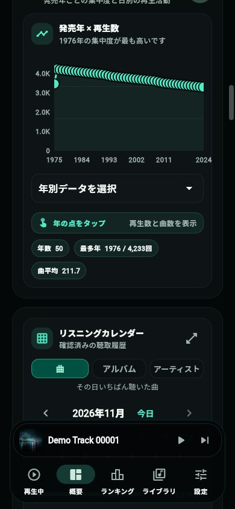

# 起動・分析パネルの短い停止の追加改善

## 変更

- Web の GlassSurface のぼかし付き影を省き、既存の面色と境界線で区切る。下部ナビゲーションも Web のみ背景ぼかし・影を省き、背景の不透明度を上げた。ネイティブの影・ぼかしは維持。
- 発売年のデータ選択を PopupMenuButton に変更。約50年分の候補の生成は、メニューを開くまで行わない。選択操作と年別データの表示は維持。
- カレンダーの週を RepaintBoundary で分離。週の段階表示やアートワーク更新による再描画をその週に限定する。

## 計測

Windows 上の実際の Chromium / Flutter Web profile / CanvasKit。390×844、デモ1,000曲、表示状態のタブ。各ビルドを一度開いてキャッシュを温め、変更前（8817）と最終修正版（8821）を交互に各3回計測。CPU Profiler は通常比較時には停止・無効化。測定中にビルドやテストは実行していない。

起動は `data-ready - 50ms` から `content-frame + 500ms` まで、分析は概要を開いて900ms後から最初の2回のページスクロールを各1,800ms計測。後半のカレンダーも比較範囲に含める。`loading_preview=1` の意図的な4秒待機は起動時間の評価に含めない。

数値は requestAnimationFrame 間隔の最大値。各3回の中央値であり、Flutter の厳密なラスタ時間や端末上の FPS ではない。

| 指標（ms） | 変更前の各回 | 修正後の各回 | 中央値 前→後 |
| --- | --- | --- | --- |
| 起動切り替え付近の最大フレーム間隔 | 120.0 / 106.7 / 133.3 | 106.6 / 133.4 / 106.7 | 120.0 → 106.7 |
| 分析の最初の2スクロールの最大フレーム間隔 | 66.6 / 53.3 / 66.7 | 66.6 / 40.1 / 40.0 | 66.6 → 40.1 |
| data-ready から content-frame マークまで | 61.1 / 62.8 / 88.5 | 101.6 / 113.1 / 85.1 | 62.8 → 101.6 |

短い停止のピークには改善がある。一方、最初の content-frame マークまでの時間はこの比較では増えており、初回表示そのものが速くなったとは判断しない。起動の約100ms級の停止と、分析の最大66.6msの間隔は残る。完全解消とはしない。少数回のローカル比較であり、iPhone / iPad ネイティブ版の実機計測ではない。

詳細な通常計測値・対象フレームは [JSON](short-pause-followup-2026-11-15.json)。初期比較（after）と最終比較（final / paired-before）を両方残した。最終結果の集計は final-1〜3 と paired-before-1〜3 のみ。

## 原因の補助確認

起動の V8 CPU サンプリング（100µs）では、WebGL の getShaderParameter / getProgramParameter が初回描画付近で目立った。影・背景ぼかしを省いた試行で、同区間の当該関数のサンプル自己時間合計は約45.5→27.4ms。プロファイラによる負荷があるため、この値は通常比較の改善率には用いない。生のCPUプロファイルは build/short-pause-startup-cpu*.json に保持（生成物、Git対象外）。

## 検証

- startup_loading_widget_test / widget_test / listening_maps_widget_test：58件成功。
- 週の RepaintBoundary 追加後 listening_maps_widget_test 再実行：23件成功。
- 関連ファイル dart analyze：問題なし。
- Web profile ビルド成功。既存の CupertinoIcons フォント参照警告あり。
- 年選択メニューが開き、1976年の項目を選択できることをブラウザで確認。
- git diff --check：エラーなし（既存ファイルの改行コード警告のみ）。

コミット・プッシュ・公開は行っていない。
